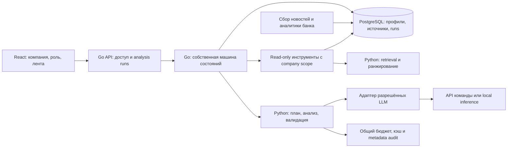

# Архитектура после переноса BrandRadar

Решение: сохранить Go/Gin backend, React/TypeScript frontend, PostgreSQL/Redis и Python/FastAPI сервис. Это заменяет первоначальное предложение писать новый backend на FastAPI. Существующая архитектура BrandRadar — baseline; новые компоненты ниже ещё не реализованы.

## Границы сервисов

Go владеет публичным API, авторизацией, состояниями и переходами RunContext, хранением результатов, проверкой прав и исполнением разрешённых инструментов. Python получает минимальный контекст по внутреннему контракту, возвращает schema-valid результаты и запросы на инструменты; не управляет вторым циклом задания. Python владеет адаптером провайдера и атомарным резервированием общей стоимости перед каждым вызовом; Go ограничивает весь run по deadline/tool calls/попыткам. Все вызовы к LLM, включая вспомогательные, идут через один бюджетный путь.

Данные: исходные признаки с provenance; типизированные SQL-связи платежей и общих физлиц; документ с URL/датами/hash и фрагментами до страницы. Регистрационный регион не равен географии деятельности, платежи не доказывают поставки, продуктовый маркер не содержит сумму экспозиции. Поиск начинается с лексики/словарей, embedding требует уточнения допустимости.

## Собственная агентная логика

Go: PLAN → PROFILE → RETRIEVE → RANK → ANALYZE → VERIFY → DONE / PARTIAL / FAILED.

PLAN возвращает структурированный план нужных данных/источников. Go валидирует tool allowlist, scope и лимиты. Инструменты: `get_company_context`, `get_relationships`, `search_news`, `search_bank_research`, `read_source`. RunContext хранит признаки, источники, основания выводов, шаги и бюджет. Запросы источников не дают модели shell или произвольный HTTP.

VERIFY проверяет JSON, разрешённость и существование evidence, точные quotes/locator, поддержку выводов признаками клиента и датированными источниками, различие позиции банка и AI. При нехватке — один уточнённый поиск и повторный анализ, максимум 2 попытки анализа. После исчерпания — PARTIAL с конкретными пробелами. Конфликт документов сохраняется с датами. Структурная проверка не заменяет экспертную оценку смысла.

## Лимиты и модели

Точные разрешённые model ID/checkpoint из требований и ответа организаторов, неизвестный ID — отказ. API/local/mock реализуются отдельно, mock всегда помечен. Нельзя считать текущие ruBERT/SBERT разрешёнными без уточнения. Не загружать старые модели в новом API-пути по умолчанию.

Адаптер поддерживает timeout, ограниченные retries, typed output и кэш по модели/prompt/data versions. Резерв стоимости до вызова атомарный на всю команду, затем сверка usage; при неизвестных тарифах или reset timezone соблюдение бюджета не доказано. Лимит 500 ₽/день. Сбой LLM не должен прекращать сохранение исходных материалов.

## Наследованные компоненты

Go module `prod-pobeda-2026` пока сохранён ради точности импорта. В backend присутствуют crawler/analytics/clustering/anomalies, API/репозитории и мониторинг. Frontend уже имеет ленту, фильтры и detail panel. MinIO и старые модели остаются в baseline; новые режимы и миграции внедряются отдельными PR. Root Compose пока описывает исходный BrandRadar, см. migration-report.
