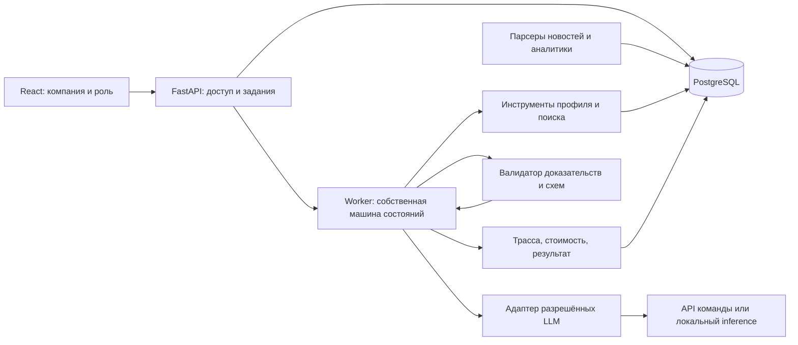

# Архитектура MVP

Предложение команды, подлежит уточнению после просмотра датасетов и теста моделей.

## Данные и поиск

Импорт CSV со словарём полей, проверкой типов/пропусков и отчётом качества; факты с происхождением. Платёжные связи и общие физлица — типизированные рёбра в SQL, без отдельной графовой БД. Новости/документы: id, источник, URL, даты, hash, тип, chunks с номерами страниц. Сначала нормализация и точные дубли, затем группировка похожих событий с сохранением всех источников. Лексический поиск + словари ОКВЭД/тем + прозрачный score; веса до оценки считаются гипотезой.

Предлагаемая формула: отрасль + подтверждённые продуктовые/географические связи + связанные компании + свежесть + приоритет роли. Каждая составляющая объяснима; отсутствующие признаки не подменяются нулевой экспозицией. Шкалу и веса калибровать на размеченных парах клиент–событие.

## Собственная агентная логика

Состояния: PLAN → PROFILE → RETRIEVE → RANK → ANALYZE → VERIFY → DONE / INSUFFICIENT_EVIDENCE / FAILED.

PLAN формирует структурированный план нужных данных и источников. Исполнитель проверяет список инструментов и лимиты. Инструменты: `get_company_context`, `get_relationships`, `search_news`, `search_bank_research`, `read_source`. Общий RunContext хранит профиль, найденные документы, доказательства, выполненные шаги и бюджет. Модель получает только отобранные данные, не весь CSV.

VERIFY проверяет JSON, существование ссылок и фрагментов, опору выводов на признаки и источники, сроки, противоречия и отсутствие выдуманной позиции банка. Структурная валидность не доказывает смысловую верность: нужна экспертная оценка. При недостатке данных — один уточнённый поиск и повторный анализ (максимум 2 попытки анализа), после чего частичный ответ с пробелами. При конфликте источников — сохранить конфликт и даты, не угадывать.

Лимиты: deadline выполнения, max tool calls, max output tokens, дневной денежный бюджет, ограничение параллелизма. Все переходы и причины повторов журналируются. Никаких денежных операций или исполняемого моделью кода.

## API моделей

Единый интерфейс `generate(schema, messages, budget)`, отдельные реализации API/local/mock. OpenAI-совместимость провайдера не предполагается без проверки. Точные model ID в проверяемом allowlist; неизвестный ID — отказ. Таймауты, ограниченные retry с backoff, кэш по модели/промпту/версии данных, расход tokens и стоимость. Общий дневной бюджет хранится централизованно: атомарно резервировать верхнюю оценку перед вызовом и сверять фактическую стоимость. При неизвестном тарифе не считать бюджет доказанно соблюдённым.
